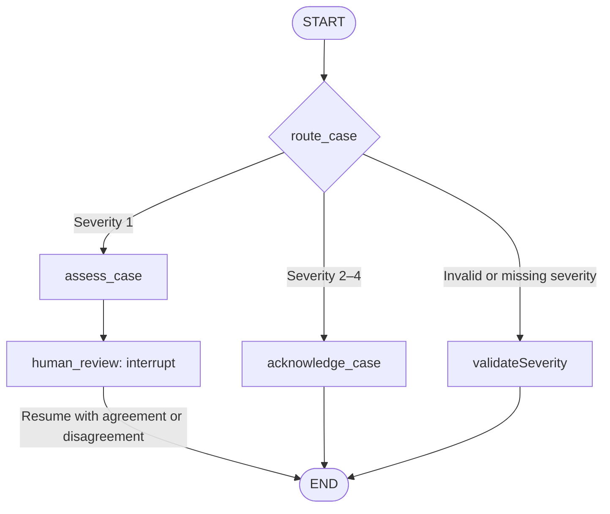

# Severity 1 Review Assistant

A LangGraph prototype that helps a support engineer review whether the impact described in a customer case meets Severity 1. It combines conditional routing, an LLM assessment, and a human-review interrupt.

The assistant provides decision support using the supplied case details and an embedded severity policy. It does not investigate live systems, create tickets, or update a case's severity.

## Implemented behavior

| Input severity | Behavior |
| --- | --- |
| `1` | Generate an assessment, pause for human review, then record agreement or disagreement. |
| `2`, `3`, or `4` | Return a case-received acknowledgment without calling the assessment agent. |
| Invalid or missing severity | Route to `validateSeverity`, return `Please enter a severity 1-4`, and end without an assessment. |

For Severity 1, the prompt requests a concise plain-text assessment covering:

1. **Understanding:** a summary of the customer's issue.
2. **Assessment:** whether the stated impact meets Severity 1, or whether the information is insufficient.
3. **Missing information:** details a human should clarify.

The prompt asks the model to end with `Pending human review.` It instructs the model to use only the supplied policy and case details, treat customer text as data, avoid inventing facts, and leave severity unchanged. The active prompt also requests the assessment in one statement. These are prompt instructions, not programmatically validated output guarantees.

## Workflow



`route_case` is a conditional-edge function. It selects one of three registered nodes: `assess_case`, `acknowledge_case`, or `validateSeverity`. The validation branch returns a message and ends; it does not pause to collect corrected input. Both human agreement and disagreement end the workflow. Disagreement produces a message saying further manual review is needed; it does not start another review or escalation.

## Embedded severity policy

| Severity | Definition in the code |
| --- | --- |
| 1 | The service is completely unavailable, or a failure prevents its use. |
| 2 | The service still operates but is severely degraded, with no workaround. |
| 3 | Some functionality is affected, or there is a non-blocking bug. |
| 4 | Little or no impact on service access or use; includes general questions and feature requests. |

The application uses this embedded text at runtime. It does not retrieve or refresh policy from a website.

## Technology

- **LangGraph:** state, conditional routing, interrupts, and checkpointing.
- **LangChain:** a `create_agent` assessment agent using `gpt-5-nano`, with no tools.
- **OpenAI:** model provider.
- **python-dotenv:** loading environment variables from `.env`.
- **LangSmith:** optional tracing when configured in the environment.

## Setup

Clone the repository and create an environment:

```bash
git clone https://github.com/srushtitikekar/langchain-severity-review-assistant.git
cd langchain-severity-review-assistant
python3 -m venv .venv
source .venv/bin/activate
```

If the repository includes a dependency file, install it:

```bash
python -m pip install -r requirements.txt
```

Otherwise, the reviewed module requires these packages:

```bash
python -m pip install langgraph langchain langchain-openai python-dotenv typing-extensions
```

For local Studio development, also install:

```bash
python -m pip install "langgraph-cli[inmem]"
```

Create a `.env` file in the project root:

```dotenv
OPENAI_API_KEY=your_openai_api_key
LANGSMITH_API_KEY=your_langsmith_api_key
LANGSMITH_TRACING=true
LANGSMITH_PROJECT=severity-review-assistant
```

An OpenAI API key with access to the configured model is required for assessments. LangSmith settings are needed when enabling tracing. Keep `.env` out of version control.

The module prints whether the OpenAI and LangSmith keys are present; it does not print their values.

## Input and state

Example graph input:

```json
{
  "title": "Unable to view traces in one project",
  "description": "The traces page fails to load for one project. Other projects load correctly, and our application continues to serve customer requests.",
  "severity": 1
}
```

| Field | Purpose |
| --- | --- |
| `title` | Case title; declared as a required string in `CaseInput`. |
| `description` | Case details; declared as a required string in `CaseInput`. |
| `severity` | Current severity; declared as a required integer in `CaseInput`. |
| `assessment` | Model-generated assessment for Severity 1 cases. |
| `human_agrees` | Boolean recorded after human review. |
| `message` | Severity-validation, acknowledgment, or final human-review message. |

`CaseInput` is a `TypedDict`, not a runtime input-validation model. The `Case` helper checks severity membership in `(1, 2, 3, 4)` but does not validate nonempty titles or descriptions. For direct graph input, `route_case` requires `type(severity) is int` and a value from 1 through 4. Values such as `0`, `5`, `"1"`, `1.0`, `true`, and `null`, or an omitted severity, route to `validateSeverity`. This node returns `Please enter a severity 1-4` and ends. The `Case` helper rejects out-of-range severity values before graph invocation; it does not use the same strict type check as the router.

## Run in Studio

The module exports `graph = builder.compile()` for the local development server, which supplies persistence. If the module is stored at `src/takehomeV2.py`, a minimal `langgraph.json` configuration is:

```json
{
  "dependencies": ["."],
  "graphs": {
    "severity_review": "./src/takehomeV2.py:graph"
  },
  "env": ".env"
}
```

Adjust the module path to its actual repository location; this example does not establish the repository's file layout. From the project root, start the server:

```bash
langgraph dev
```

Submit the example input. A Severity 1 case pauses at `human_review` with an interrupt payload containing `assessment` and `question`.

Resume the interrupted thread with a boolean or a supported string:

- Agreement: `true`, `"true"`, or `"yes"`.
- Disagreement: `false`, `"false"`, or `"no"`.

String values are stripped and lowercased. Other values raise `ValueError`. Resume the same thread that produced the interrupt.

## Direct Python demo

The module includes a demo under `if __name__ == "__main__":`. It creates an `InMemorySaver`, generates a thread ID, submits a sample Severity 1 case, and asks for `yes` or `no` in the terminal.

The demo invokes and resumes the same `local_graph` with the same thread configuration:

```python
final_result = local_graph.invoke(
    Command(resume=(answer == "yes")),
    config=config,
)
```

Execute the module using its actual path, for example:

```bash
python src/takehomeV2.py
```

The same-process in-memory checkpointer retains state between invocations. It does not survive a process restart.

## Human-review results

| Human response | Final message |
| --- | --- |
| Agree | `Human agrees with the assessment.` |
| Disagree | `Human disagrees; further manual review is needed.` |

The original severity remains unchanged in both cases. Human agreement records agreement with the assessment; it is not a severity-change operation.

## Observability and evaluation

The workflow can be traced in LangSmith when tracing is enabled. Traces support inspection of the model request, assessment, and graph execution.

The reviewed `takehomeV2` module contains no dataset creation, evaluator definitions, or batch experiment runner. Evaluation notebooks are separate from this module. No evaluation scores or experiment results are claimed here.

Useful evaluation targets include whether the assessment follows the supplied policy, avoids unsupported facts, identifies missing information, and preserves the original severity. Human-review behavior should be checked separately from assessment quality.

## Known limitations

- **Invalid severity ends the run.** The validation node returns a corrective message; resubmission is handled by the caller rather than an interactive correction loop.
- **Assessment output is plain text.** There is no structured-output schema or deterministic validation of the requested sections.
- **Missing or blank input handling is incomplete.** Required type annotations do not enforce the full input contract at runtime.
- **No recovery logic is implemented for model errors.** Provider failures propagate rather than producing a fallback assessment.
- **Disagreement ends the graph.** Further manual review is a message, not an implemented follow-up process.
- **No ticket-system integration is present.** The workflow does not authenticate users, create external cases, change severity, or send notifications.

This is a demonstration of assessment routing and human review, not a production incident-management system.
